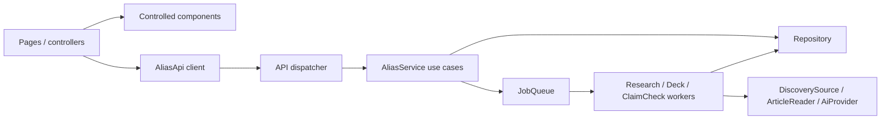

# Shared interfaces and working agreement

Backend services, account sessions, Postgres persistence, provider adapters, durable workers, and cron authorization are implemented against these contracts. Frontend forms and prep/live controllers use the typed HTTP client by default; fictional memory/mock APIs require explicit opt-in. Seven checks passed against disposable PostgreSQL. Production deployment, live provider output, and live email delivery remain unverified; see the README.

## Ownership

| Area | Owner | Files |
| --- | --- | --- |
| Domain, requests, responses, component props | Both agree | `src/contracts/*`, `src/components/contracts.ts` |
| Pages, UI, client controllers | A | Page files, `src/components/*`, `src/lib/api-client.ts` |
| Use cases, persistence, research, AI, jobs | B | `src/server/*`, `src/app/api/*` |
| Examples and compatibility checks | Both | `src/fixtures/*`, `tests/*` |

Coordinate changes to shared fields, statuses, routes, and callbacks before merging. Add matching fixtures and checks when a boundary changes. Internal database/provider types must never become frontend props.

## Connections



`src/contracts/domain.ts` owns serialized entities. `src/contracts/operations.ts` owns the registry and derives `AliasApi` and `AliasService`. `src/server/ports.ts` owns backend dependency interfaces. UI imports shared contracts; server adapters are marked `server-only`.

## Serialization

- IDs are opaque nonempty strings. Do not parse IDs or assume UUIDs.
- Dates are ISO 8601 strings with a timezone. Emit UTC (`...Z`); never serialize raw database Date objects as props.
- Explicit absence uses `null`, including unknown publication dates and first-conversation cutoffs.
- `Input<K>` describes caller input; `ParsedInput<K>` includes defaults applied before the service runs.
- Lists accept `{ cursor?: string | null, limit?: number }`, defaulting to `null` and `25`, with limit at most `100`. Responses are `{ items, nextCursor }`.
- Updates replace editable fields using a complete `data` object, not a partial PATCH.
- List ordering: people/interests by creation time then ID, ascending; claims/conversations/facts/runs/decks by creation time then ID, descending. Cursors are opaque and scoped to the list/filter. Cards use ascending `position`.

## Transport

All application operations use authenticated `POST /api/v1/<operationName>` with JSON, including reads. One registry avoids maintaining a separate URL/query mapping. Use `createApiClient()` in controllers. Browser calls use the same origin; Node calls need an absolute `baseUrl` and session credentials. Responses use `Cache-Control: private, no-store`.

Better Auth handles email/password signup, signin, signout, and sessions at `/api/auth/*`; the client is `src/lib/auth-client.ts`. Passwords require 10–128 characters. Configure `DATABASE_URL`, a random `BETTER_AUTH_SECRET` of at least 32 characters, and `BETTER_AUTH_URL` as an explicit origin (HTTPS in production). Optional `RESEND_API_KEY` and `AUTH_EMAIL_FROM` must be supplied together; they enable required email verification and password reset. Reset revokes existing sessions. Cookies are HttpOnly and secure in production; sessions are checked in the database and auth rate limits persist there.

The operation dispatcher rejects anonymous requests before constructing a service, rejects foreign browser origins, and derives its immutable user scope exclusively from the session. Missing/malformed auth configuration fails closed. Caller-supplied identifiers cannot change that scope; inaccessible private entities return `NOT_FOUND`.

| Operations | Purpose |
| --- | --- |
| `getIdentity`, `saveIdentity` | One private cover identity per account |
| `listInterests`, `createInterest`, `updateInterest`, `deleteInterest` | Topics |
| `listPeople`, `getPerson`, `createPerson`, `updatePerson`, `deletePerson` | People and topic links |
| `listClaims`, `createClaim`, `getClaim` | Claims and check status |
| `recordConversation`, `listConversations` | Post-call recording/history |
| `startResearch`, `getResearchRun`, `listResearchRuns`, `listResearchFacts` | Research jobs/timeline |
| `buildDeck`, `getDeck`, `listDecks` | Deck jobs/snapshots |

Success: `{ ok: true, data: <output> }`, HTTP 200. Job trigger success means a status was returned, not that processing completed. Deletes return `data: null`.

Failure: `{ ok: false, error: { code, message, retryable } }`.

| Code | HTTP |
| --- | --- |
| `VALIDATION_ERROR` | 400 |
| `UNAUTHORIZED` | 401 |
| `UNAUTHORIZED` (foreign origin) | 403 |
| `NOT_FOUND` | 404 |
| `CONFLICT` | 409 |
| `UPSTREAM_ERROR` | 502 |
| `INTERNAL_ERROR` | 500 |
| `NOT_IMPLEMENTED` | 501 |
| `INTERNAL_ERROR` (auth unavailable/configuration failure) | 503 |

The client throws `AliasApiError` for error envelopes and a validation error for malformed responses. Controllers map failures to the UI's `ApiError`. Use `ServiceError` for expected backend failures. Output schema failures return HTTP 500 without leaking details.

`POST /api/cron/research` is separate: `Authorization: Bearer <CRON_SECRET>`, no body; success data is `{ runIds: string[] }`. Missing server secret returns 503 and invalid authorization returns 401 before runtime construction. The scheduler queues durable runs; a separate worker executes them.

## Behavior agreements for implementation

### Identity and relationships

- Each email/password account has exactly one private cover identity, enforced even for concurrent saves. Accounts cannot adopt legacy singleton data: migrated rows with no owner remain inaccessible.
- Skills/interests have public/private visibility and belong to their creator's identity. Public skills are readable/linkable by other accounts, but updates and deletion remain creator-only. Private skills are visible only to their owner. People and interests have a many-to-many link.
- People, conversations, claims, decks, cards, and immutable snapshots remain account-private. Public research is shared according to its skill's visibility; workers retain a separate system scope.
- Deck research uses the person's explicit `interestIds`. An empty selection means no topic research.
- Missing entities return `NOT_FOUND`. Reject references to missing interests, and claims tagged with a topic not linked to that person.
- Delete people with their conversations, claims, and decks transactionally. Deleting an interest linked to a person returns `CONFLICT`; unlink it first. Preserve evidence URLs in historical decks if topic research is deleted.

### Claims and conversations

- `createClaim` saves independently of its AI check and never changes the conversation cutoff.
- `recordConversation` atomically saves the conversation and claims and returns `{ conversation, claims, person }`.
- `saidAt` is when a claim was said; `createdAt` is when it was logged. Recording a conversation assigns the claims' `conversationId`.
- Update `lastConversationAt` to `max(existing, happenedAt)`. Backfilled conversations cannot move it backward.
- Check lifecycle: `queued → running → completed | failed`. A failed check retains the claim and exposes `checkFailure`. A completed check may have no contradictions.
- Contradictions reference earlier claims for the same person; warnings never block saving.

### Research

- Facts belong to interests, not people, and retain source URLs, dates, source kind, and fact/reaction/context labels.
- New discovery filters known-date news to the last 30 days and requires topic relevance in title/URL path. Literal C++/C# punctuation is preserved. Wikipedia remains background context, and unknown dates remain eligible without invented publication dates. Existing historical runs/facts are unchanged.
- Google News must resolve to a readable publisher URL; opaque redirect/consent pages produce an explicit source error rather than evidence.
- `startResearch` returns a run ID/status. Atomically reuse a queued/running run for duplicate triggers on one interest.
- Lifecycle: `queued → running → completed | failed`. Partial success can complete with `sourceErrors`. Overall failure uses `failure`.
- UI polls `getResearchRun` until terminal, then refreshes facts. Controllers own polling and cancellation.
- Deduplicate article URLs per topic and fact text per source/topic; `upsertFacts` must be retry-safe.
- `upsertFacts` returns newly inserted rows. `factCount` counts inserts observed across attempts of that run; existing facts are not reassigned to later runs. Discovery is sampled across sources, with at most six unique articles processed per attempt.
- `since` filters publication date, falling back to retrieval date, strictly later than cutoff. `null` includes all available research. Research never changes the conversation cutoff.

### Decks and cards

- `buildDeck` returns ID/status; poll `getDeck` until terminal. Queued/running/failed decks have no usable cards.
- Decks snapshot the person, selected claims/facts, and cutoff. Editing data does not mutate saved decks.
- `force: false` may reuse a matching deck. `true` requests a fresh snapshot, but an identical active build is still reused to prevent duplicate work.
- Cache fingerprints include identity/person/interest content, claim content/check results, facts, cutoff, model, and prompt version. Persist enough input content to reproduce that snapshot; workers must not silently include newer data.
- Workers reject snapshots whose prompt version or configured model is no longer supported. Rebuild after changing model/prompt configuration. Cards are sorted by `position` before saving.
- Fixed types: `back_story`, `what_changed`, `if_she_asks`, `dont_say`.
- Evidence is a claim reference, or a fact reference with source URL. Do not fabricate news sources for personal claims.
- `interestIds` drive topic filters; `position` drives order. Card `deckId` must match the parent.
- No research produces a warning and may allow claim-based cards. Missing identity/person is an error. Provider failure sets failed status with `failure`.

## UI handoff

`src/components/contracts.ts` defines controlled props for all features. Pages/controllers own fetching and mutations; components receive data/state and callbacks. Async callbacks return the saved result.

Use the same dependency type for the live client and static mock:

```ts
import { createApiClient } from "@/lib/api-client";
import { mockApi } from "@/fixtures/mock-api";
import type { AliasApi } from "@/contracts";
const real: AliasApi = createApiClient();
const preview: AliasApi = mockApi;
```

Choose explicitly in a controller. No automatic production fallback to mocks. Static reads ignore IDs/filters/pagination; all writes reject. Fixtures are fictional shape examples. Explicit memory mode supplies a writable fictional UI demo; the database maintenance seed is unowned and inaccessible to signed-in accounts.

## Database handoff

`src/server/db/schema.ts` defines the physical schema. `createPostgresRepository` implements `Repository`; the SQL migration runner is authoritative. DTO payloads are stored alongside indexed relationship/status fields. See `src/server/db/README.md` before generating migrations.

| Table | Keys / relationships |
| --- | --- |
| auth_user / auth_session / auth_account / auth_verification / auth_rate_limit | Account credentials, sessions, verification, persistent limits |
| identities | Unique account owner FK (nullable only for legacy/maintenance data), cover, background, timestamps |
| interests | Creator identity FK, public/private visibility, search terms, feed URLs |
| people | Identity FK, notes, last conversation timestamp |
| person_interests | Unique person + interest pair |
| conversations | Person FK, happened-at, notes |
| claims | Person FK, optional conversation/topic FKs, said-at, check results |
| research_runs | Interest FK, lifecycle, errors, counters |
| research_facts | Interest/run FKs, text/kind, source metadata, dedup key |
| decks | Person FK, lifecycle, cutoff, input snapshot/fingerprint, warnings |
| cards | Deck FK, type/order, prompt/answer, topic links, evidence |
| jobs | Job kind/entity ID, retry/lease state |

Backend owns indexes, constraints, queue durability, and transactions. DTO timestamps remain ISO strings. Queue triggers insert entities and jobs in the same transaction. Job claims use row locks, leases, up to three attempts, and bounded backoff. Failed attempts with remaining retries return the entity to `queued`, with null terminal failure/finishedAt, retaining the active deduplication slot and frontend polling. Only exhausted attempts expose `failed`. Direct worker calls without a retry context are treated as final attempts. Expired final leases mark the entity failed; superseded research/deck retries are cancelled when newer work owns the active slot.

## Remaining integration

1. Configure Render auth secrets/origin, provider/model, and optional email delivery; deploy migrations/web/worker and verify production persistence/provider behavior. Daily cron is not included in the Free Blueprint.
2. Run the full signed-in UI workflow, verify live email if configured, and rehearse the deployed demo. Mocked backend checks and disposable PostgreSQL checks do not replace that integration check.

AI debrief is unspecified in `alias.md`; define behavior together before adding a contract.
